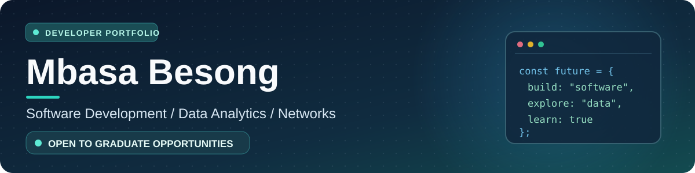
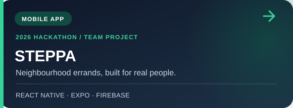
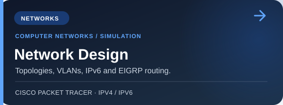
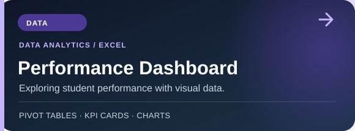
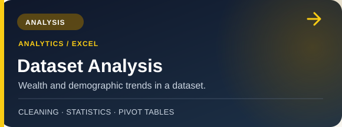
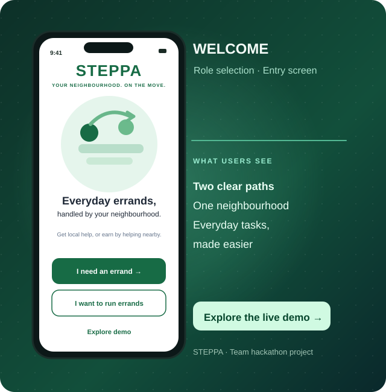

 

  

**BSc Computer Science & Mathematics graduate** · **BSc Honours (Computer Science), NWU**

Software development. Data analytics. Solving real problems.

---

## Tech stack

  

## Selected work

<table>
<tr>
<td width="50%" valign="top">

</td>
<td width="50%" valign="top">

</td>
</tr>
<tr>
<td width="50%" valign="top">

</td>
<td width="50%" valign="top">

</td>
</tr>
</table>

STEPPA was developed as a team entry for the FNB App of the Year Hackathon 2026. My main contribution was the requester (Stepper) home dashboard. Click any card to explore the project.

## STEPPA · See the product

**Your Neighbourhood. On the Move.**

A team-built neighbourhood errand app developed for the **FNB App of the Year Hackathon 2026**.

<table>
<tr>
<td width="50%" valign="top">

</td>
<td width="50%" valign="top">

</td>
</tr>
</table>

Visual illustrations based on STEPPA's current welcome and requester dashboard source code — not captured app screenshots. My focus was the requester dashboard. STEPPA is a team project and the demo is a work in progress.

## Beyond the code

- **2026 – Present** · BSc Honours in Computer Science, **North-West University**
- **2026 – Present** · Database Student Assistant, **North-West University**
- **2022 – 2025** · BSc Computer Science and Mathematics, **North-West University**

**Interested in graduate programmes, software engineering and data-focused opportunities.**

